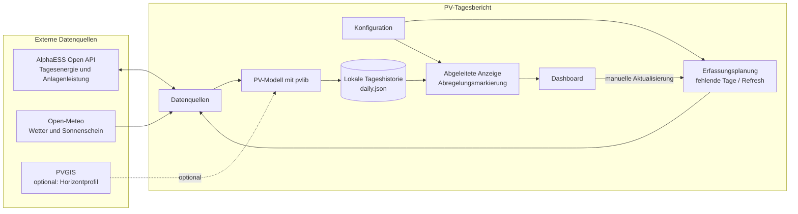
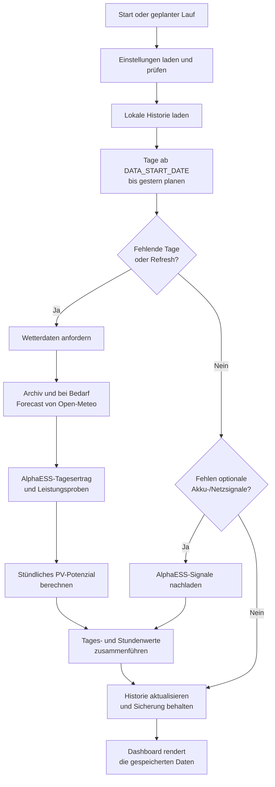
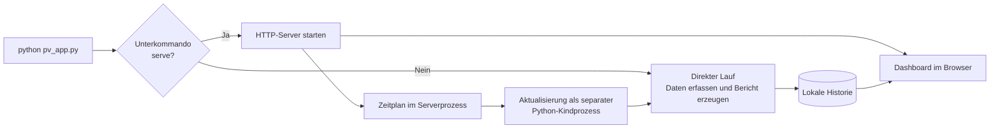

# PV-Tagesbericht – Funktionsübersicht

PV-Tagesbericht vergleicht den gemessenen Solarertrag einer AlphaESS-Anlage mit
einem wetterbasierten PV-Modell. Die Anwendung speichert Tageshistorien lokal
und stellt sie als interaktives Dashboard bereit. Sie kann direkt als Python-
Programm laufen oder als Server, zum Beispiel auf einem Raspberry Pi im
Heimnetz.

Für Installation, Konfiguration und Startbefehle siehe [README.md](./README.md).

## Überblick

Die App speichert die Tageshistorie als JSON-Datei. Das Dashboard wird daraus
bei einer Browseranfrage erzeugt; es liest die externen APIs nicht selbst aus.
Die täglichen Zeitreihen und Kennzahlen werden lokal verwaltet, sodass der
Bericht auch ohne eine laufende Aktualisierung aus den zuletzt gespeicherten
Daten angezeigt werden kann.

## Datenerfassung und Berechnung

### Zeitliche Abdeckung

- Die Zeitzone aus `TIMEZONE` bestimmt die lokalen Tagesgrenzen.
- Der reguläre Erfassungsplan umfasst vollständige Tage ab `DATA_START_DATE`
  bis einschließlich gestern. Der laufende Tag wird nicht als vollständiger
  Datensatz dargestellt.
- Fehlende Tage werden nachgeholt. `BACKFILL_MAX_DAYS` begrenzt die Zahl der
  Tage, die ein einzelner Lauf zurückgeht; der Standardwert ist 14.
- Ein Refresh kann gespeicherte Tage neu abrufen. Der automatische Pi-Lauf
  aktualisiert einmal täglich um `UPDATE_TIME` (Standard 05:30) den jüngsten
  abgeschlossenen Tag.
- Fehlt ein optionales Signal für die Abregelungserkennung in älteren
  Datensätzen, kann die App die Signale separat nachladen.

### AlphaESS-Daten

Die App meldet sich mit `ALPHAESS_APP_ID` und `ALPHAESS_APP_SECRET` an. Bei
mehreren Anlagen kann `ALPHAESS_SYSTEM_SN` die gewünschte Anlage festlegen.
AlphaESS liefert den Tagesertrag und, wenn verfügbar, Leistungsproben über den
Tag. Die Leistungsproben werden in Stundenwerte verdichtet und auf den
gemeldeten Tagesertrag skaliert.

Zwischen AlphaESS-Aufrufen gilt `API_REQUEST_INTERVAL_SECONDS` als
Mindestabstand, um die API nicht unnötig häufig aufzurufen. Fehler einzelner
Tage verhindern nicht automatisch die Verarbeitung aller anderen Tage.

### Wetter und PV-Modell

Open-Meteo liefert stündliche Wettergrößen wie Temperatur, Wind und
Sonnenstrahlung sowie Sonnenscheindauer. Im automatischen Modus nutzt die App
das Wetterarchiv und ergänzt fehlende oder noch nicht vollständige Tage über
die Forecast-API. Ein Tag gilt mit mindestens 22 Wetterstunden als vollständig.

Das Modell berechnet die Einstrahlung auf die Modulfelder, berücksichtigt
Modul- und Temperaturparameter sowie Wechselrichterwirkungsgrad und
Systemverluste. Ost- und Westfelder werden getrennt modelliert und anschließend
zusammengeführt. Optional lassen sich Einfallswinkelverluste, ein
PVGIS-Horizontprofil und ein Rückseitengewinn für bifaziale Module einbeziehen.

### Abregelungserkennung

Die optionale Heuristik markiert eine Stunde als wahrscheinlich abgeregelt,
wenn

1. der Ist-Ertrag deutlich unter dem modellierten Potenzial liegt,
2. das Potenzial über einer Mindestschwelle liegt und
3. ein konfiguriertes Einspeiselimit erreicht wird oder der Akku nahezu voll
   war.

Die Erkennung ist ein Hinweis, kein sicherer Nachweis: Eine Abweichung kann
auch aus Modellfehlern oder anderen Anlagenbedingungen entstehen. Rohsignale
werden stündlich gespeichert; die Markierungen können bei neuen
Schwellwerten beim nächsten Bericht erneut berechnet werden.

## Dashboard

Das Dashboard zeigt:

- Kennzahlen des jüngsten gespeicherten Tages: Ist-Ertrag, potentieller Ertrag
  und Sonnenscheindauer.
- Verlauf der Ist- und Modellenergie sowie Sonnenstunden und Ist/Potenzial-
  Verhältnis.
- Zeiträume von 7, 30 oder 90 Tagen sowie die gesamte Historie.
- CSV-Export der Tagesdaten.
- Stundenprofil mit gemessener und modellierter Energie je Stunde, sofern
  Stundenwerte erfasst wurden.
- Hinweise auf wahrscheinlich abgeregelte Stunden, sofern Signale verfügbar
  sind.

Der Server rendert die Berichtsvorlage und bettet JavaScript, CSS und die
Tagesdaten in die HTML-Antwort ein. Dadurch benötigt die Oberfläche keine
externen Frontend-CDNs.

## Betriebsarten

### Direkter Lauf

`python pv_app.py` lädt die Historie, plant Erfassungen, aktualisiert
gespeicherte Daten und erzeugt eine eigenständige HTML-Datei. Mit
`--offline` wird keine Datenquelle abgefragt; mit `--no-open` wird der Bericht
nicht automatisch im Browser geöffnet.

### Serverbetrieb

`python pv_app.py serve` startet den HTTP-Server auf Port 8765. Standardmäßig
bindet er nur an `127.0.0.1`. Für den Zugriff aus dem Heimnetz kann er mit
`--host 0.0.0.0` an allen Netzwerkschnittstellen lauschen. Die aktuelle
Raspberry-Pi-Deployment-Datei dafür ist
[`deploy/pv-tagesbericht.service`](./deploy/pv-tagesbericht.service).

Der Serverprozess ist bewusst leichtgewichtig und lädt pandas und pvlib nicht
in seinen Speicher. Die eigentliche Datenerfassung läuft bei Bedarf in einem
Kindprozess; anschließend liest das Dashboard die aktualisierte lokale
Historie.

## Einrichtung und Zugriffsschutz

Einstellungen können aus `.env`, Umgebungsvariablen oder der lokalen
Einrichtungsseite stammen. Umgebungsvariablen haben Vorrang vor den Dateien;
`.env` hat Vorrang vor `settings.env`. Die Einrichtungsseite speichert Werte in
`settings.env` im App-Datenordner. Das App-Secret wird dort gespeichert, aber
in der Seite nicht wieder ausgegeben.

Bei Bindung an `0.0.0.0` gilt:

- Das Dashboard ist für Geräte im Netzwerk lesbar und hat keine Anmeldung.
- Einrichtungsseite und schreibende API-Endpunkte sind auf lokale
  Loopback-Verbindungen beschränkt.
- Schreibende Anforderungen benötigen zusätzlich ein vom Server erzeugtes
  Token; fremde Origin- und Host-Header werden abgewiesen.
- Der Server gibt das AlphaESS-Secret nicht an den Browser zurück.

Der Server ist für ein vertrauenswürdiges lokales Netzwerk vorgesehen. Den
Port 8765 nicht direkt ins öffentliche Internet weiterleiten.

## Dateien und gespeicherter Zustand

| Inhalt | Speicherort/Funktion |
|---|---|
| Tageshistorie | `daily.json` im App-Datenordner; enthält Tageskennzahlen, Stundenprofile und verfügbare Signale |
| Sicherung der Historie | `daily.json.bak`; vorheriger Stand vor dem Ersetzen der JSON-Datei |
| Einstellungen der Einrichtungsseite | `settings.env` im App-Datenordner |
| Aktualisierungsstatus | `status.json`; letzter Start, Abschluss, Ergebnis und geplante Aktualisierung |
| Logs | `logs/`; rotierende Serverlogs und Ausgabe des letzten Aktualisierungslaufs |
| Horizontprofil | `horizon.json`; lokaler PVGIS-Cache, falls die Option aktiviert ist |

Der App-Datenordner heißt `PV-Tagesbericht` und liegt unter dem Benutzerordner
(unter Windows gegebenenfalls im durch `LOCALAPPDATA` bestimmten Verzeichnis).
Die Rohhistorie wird atomar geschrieben. Bei einer defekten JSON-Historie
bewahrt die App die fehlerhafte Datei auf und versucht, den vorherigen Stand
aus der Sicherung wiederherzustellen.

## Wichtige Module

| Modul | Aufgabe |
|---|---|
| `pv_app.py` | Einstiegspunkt und Auswahl zwischen Server- und Direktlauf |
| `pvapp/app.py` | Erfassungsplanung, Tagesverarbeitung und Berichtslauf |
| `pvapp/server.py` | HTTP-Routen, Dashboard, Einrichtung und manuelle Aktualisierung |
| `pvapp/sources.py` | Open-Meteo-, AlphaESS- und optionaler PVGIS-Datenzugriff |
| `pvapp/model.py` | PV-Potenzialberechnung mit pvlib |
| `pvapp/curtailment.py` | Erkennung wahrscheinlicher Abregelung |
| `pvapp/storage.py` | JSON-Historie, Validierung, Sicherung und Wiederherstellung |
| `pvapp/report.py` | Rendern und Erzeugen des eigenständigen HTML-Berichts |
| `pvapp/updater.py` | Separater Aktualisierungsprozess, Status und Tageszeitplan |
| `pvapp/settings.py` / `pvapp/config.py` | Einrichtungsformular, Konfiguration und Validierung |
| `site/` | HTML, CSS und JavaScript des Dashboards |
| `tests/` | Python- und optionale JavaScript-Tests |
